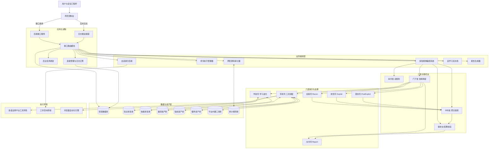
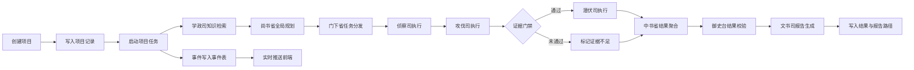
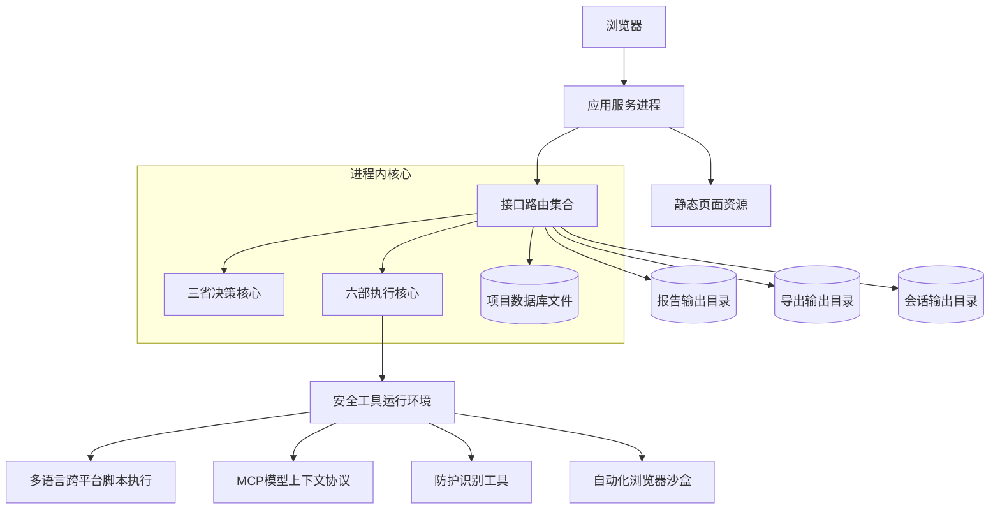
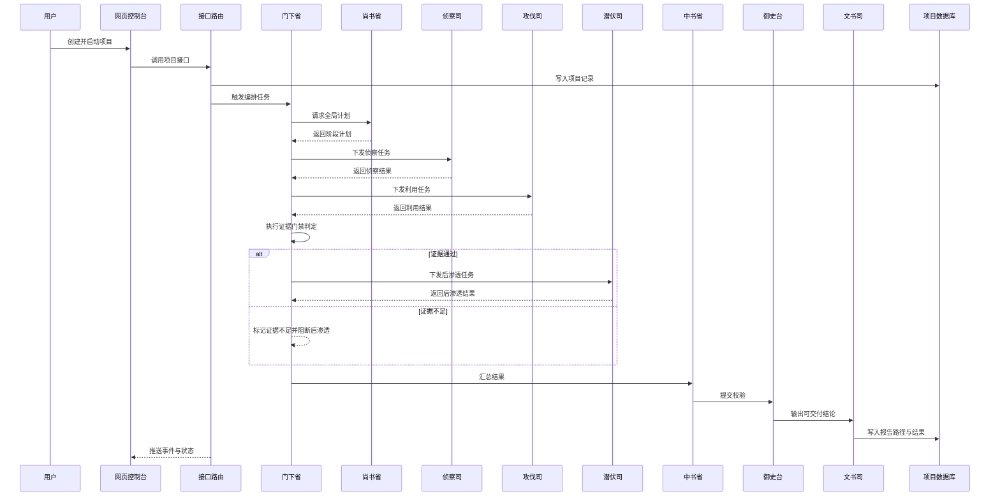

# 雾刃 AI 自动化渗透测试平台（WRAPT）

- 研发单位：玄坤信安科技有限公司
- 所属单位：玄坤信安科技有限公司
- 产品版本：V1.0.4
- 开源仓库：https://github.com/JXJZJWHCM/WuRen
- 开源协议：GNU General Public License v3.0（见仓库根目录 `LICENSE`）
- 版权所有：玄坤信安科技有限公司。在遵守 GPLv3 的前提下，可以复制、修改和再分发本项目源代码
- 「雾刃」「WRAPT」名称与标识的商标、商号权利仍归玄坤信安科技有限公司所有，GPLv3 不授予这些名称的商标使用权
- 该平台需要基于 Linux 系统运行，当前支持 Kali、Debian、Ubuntu
- 联系方式：客服微信 phenomenal233，微信公众号「玄坤信安」，官网 https://www.xuankunsec.com

---


---

## 1. 项目定位与目标

雾刃（WRAPT，WuRen AI Automated Penetration Testing Platform）是一个面向授权安全测试与攻防演练场景的 AI 自动化渗透平台。  
它不是“单点扫描器”，而是一个以 **多智能体协作 + 跨平台工具执行 + 证据门禁 + 报告闭环** 为核心的端到端系统。

系统目标：

- 输入一个合法目标（IP/域名），自动推进侦察、利用、后渗透、报告流程。
- 将 AI 推理和工具输出统一沉淀为结构化项目状态与事件流水。
- 采用 **纯跨平台、无环境强依赖** 的架构，自动管理和调用本地/自生成的工具脚本（支持 Python/Java/Go/PHP）。
- 将“无证据结论”降级为线索，并阻断高风险后续动作，降低误报失控风险。
- 提供可运营的 Web 控制台，支持实时观察、手动干预、资产库管理和结果导出。
- WebUI 不再做远程设备认证。打开根路径即可进入主控制台，不需要官网账号、设备租约或云端续期。

---

## 2.2 AI 厂商与官方协议

- 平台当前支持 10 类官方/本地 AI 厂商连接：`小米 MiMo`、`月之暗面 Kimi`、`智谱 GLM`、`深度求索 DeepSeek`、`阿里千问 Qwen`、`稀宇 MiniMax`、`ChatGPT（OpenAI）`、`Gemini`、`Claude`、`Ollama`，并保留 `Custom AI` 兼容接口。
- 模型目录以 `core/ai/model_catalog.py` 为单一真源，经 `core/ai/provider_catalog.py` 暴露。WebUI 通过 `GET /api/webui/settings/providers/catalog` 获取厂商、计费方案、协议、模型和接口。
- 目录按 2026-10-17 官方文档核对。设置页的「请求源」可以选择按量接口，以及与按量接口不一致的 Token Plan / Coding Plan 接口。
- 套餐密钥和按量 API Key 不能混用。部分厂商明确限制套餐密钥只能用于官方允许的交互式编程工具，选错地址或密钥会返回 401。
- `Ollama` 默认连接 `http://127.0.0.1:11434/v1`。`Custom AI` 支持 `OpenAI Compatible`、`Anthropic Messages`、`Google Gemini` 三种协议。
- 运行时先在当前厂商内按 `model -> failover_models` 尝试；当前厂商全部失败后，再按 `provider_failover_order` 切换已配置厂商。

| 厂商 | 默认请求源 | 默认可选调用方式 | 默认模型 |
| --- | --- | --- | --- |
| DeepSeek | `official` | 按量 OpenAI / OpenAI `/v1` / Anthropic。未见独立 Token Plan 根域名 | `deepseek-v4-pro` |
| MiniMax | `cn` | 中国/国际按量 OpenAI 与 Anthropic；Token Plan / M Plan 使用同址但必须换订阅密钥，并开放 `MiniMax-M3.1-Flash-Preview` | `MiniMax-M3` |
| GLM | `official` | 按量 `https://open.bigmodel.cn/api/paas/v4`；Coding Plan OpenAI `.../api/coding/paas/v4`；Coding Plan Anthropic `.../api/anthropic` | `glm-5.3` |
| Qwen | `cn_beijing` | 按量地域 OpenAI / Anthropic；Token Plan `token-plan.cn-beijing.maas.aliyuncs.com`；Coding Plan `coding.dashscope.aliyuncs.com` | `qwen3.8-max` |
| Xiaomi MiMo | `official` | 按量 `api.xiaomimimo.com`；Token Plan 中国/新加坡/欧洲集群，OpenAI 与 Anthropic 分开 | `mimo-v2.6-pro` |
| Kimi | `official` | 开放平台 OpenAI / Anthropic。会员密钥与按量 Key 不通用，当前官方未单列另一套根域名 | `kimi-k3` |
| OpenAI | `official` | `https://api.openai.com/v1`。ChatGPT 订阅不是独立 API 端点 | `gpt-6-astra` |
| Gemini | `official` | `generativelanguage.googleapis.com/v1beta`。未见独立 Token Plan 根域名 | `gemini-4-argon` |
| Claude | `official` | `https://api.anthropic.com/v1`。claude.ai 订阅不是独立 API 端点 | `claude-opus-5-5` |
| Ollama | `local` | 本地或自托管 OpenAI 兼容地址 | 本地已安装模型 |
| Custom AI | `manual` | 用户自填地址，可选三种协议 | 用户输入 |

## 2. 你可以把 WRAPT 理解成什么

从工程角度，WRAPT 可以拆成 8 层：

1. **接入层**：WebUI 静态前端 + FastAPI 接口
2. **编排层**：项目生命周期管理、异步任务管理、事件广播
3. **智能体层**：Main/Coordinator/Recon/Exploit/PostExploit/Aggregator/Verifier/Report
4. **执行层**：CLI、会话后端、跨平台 ToolManager、Web 审计、报告生成
5. **知识层**：RAG（knowledge + skills）、支持双引擎（DuckDuckGo/Bing）的自学习流水线
6. **数据层**：SQLite（项目、事件、导出、设置、会话）
7. **资产层**：vuldb/fingerprints/plugins/repo、**POC/EXP 库 `poc_exp/`** 以及自定义工具库 `tools/custom/``
8. **运维层**：start.sh 跨平台环境治理、健康检查、后台任务

### 2.1 三省六部制度（平台治理模型）

为避免“单模型单线程决策”带来的失控风险，WRAPT 采用“三省六部”治理模型来组织 AI 决策与执行：

- **三省（决策与监督）**
  - **尚书省（Main Planner）**：全局目标拆解、攻击路径规划、策略优先级定义。
  - **门下省（Coordinator）**：任务编排、上下文接力、阶段调度与状态推进。
  - **中书省（Aggregator）**：多源结果归并、阶段成果提炼、交付输入统一化。
  - **御史台（Verifier）**：对聚合结果进行真实性与可交付性校验，控制幻觉与误判。
- **六部（执行与支撑）**
  - **侦察司（Recon）**：资产发现、指纹识别、服务识别、初始情报沉淀。
  - **攻伐司（Exploit）**：漏洞验证、利用尝试、证据抽取与利用链推进。
  - **潜伏司（PostExploit）**：后渗透、权限巩固、横向移动与会话扩展。
  - **文书司（Report）**：结果编写、风险分级、修复建议与报告产物输出。
  - **军机司（ToolDispatcher 能力层）**：统一工具编排、参数治理、输出规范化。
  - **学政司（RAG + Self-Learning 能力层）**：知识检索、联网学习、技能动态查找（`search_and_install_agent_skills`）、实战总结与自我进化（`record_learning_experience`）。

> 说明：代码层面已实体化 4 个执行 Agent（Recon/Exploit/PostExploit/Report），其余 2 部由能力层（工具调度与学习进化）承担。

---

## 3. 深度系统架构图（组件级）

### 3.1 全链路组件图（含三省六部）



### 3.2 运行时数据流图（项目执行）



### 3.3 部署拓扑图（单机默认形态，含三省六部）



### 3.4 运行流程图（新增，职责视角）



---

## 4. 技术栈逐项拆解（揉碎版）

### 4.1 Python 3.10+

- **用途**：统一后端、AI 编排、工具调度、存储与报告能力。
- **关键价值**：异步生态成熟、与 FastAPI/Pydantic/OpenAI SDK 配套好。
- **落地点**：全仓核心代码。

### 4.2 FastAPI

- **用途**：对外 HTTP API + WebSocket + 生命周期管理。
- **关键职责**：
  - 注册 API 路由（`/api`）
  - 挂载静态站点（`/`）
  - 管理启动/关闭后台任务
- **落地点**：`main.py`、`core/api/routes.py`

### 4.3 Uvicorn

- **用途**：ASGI 服务进程。
- **关键职责**：承载 FastAPI、支持 workers、提供网络监听。
- **落地点**：`start.sh` 启动命令与 `main.py` 本地运行入口。

### 4.4 Pydantic

- **用途**：请求体/响应体模型与参数校验。
- **关键职责**：
  - ProjectCreate、ExportPolicy、CLIExecuteRequest 等模型约束
  - 限制字段长度、范围、默认值
- **落地点**：`core/api/routes.py`。

### 4.5 SQLite

- **用途**：本地持久化与轻量事务存储。
- **关键职责**：
  - 项目主记录与运行状态
  - 事件流水
  - 导出任务与审计
  - WebUI 会话状态
  - 系统设置（key、策略等）
- **落地点**：`core/api/storage.py`，数据库文件 `output/projects/projects.db`。

### 4.6 Loguru

- **用途**：统一日志输出并桥接到实时事件流。
- **关键职责**：
  - 控制台日志输出
  - 通过 `log_sink` 转换为前端实时日志事件
- **落地点**：`main.py`、`core/api/routes.py`。

### 4.7 AI Provider Catalog

- **用途**：作为 AI 厂商、官方 endpoint、协议、地域、模型列表、迁移规则的单一真源。
- **关键职责**：
  - 管理 9 家官方厂商，以及 `Ollama` / `Custom AI`。
  - 为有独立套餐地址的厂商提供按量、Token Plan、Coding Plan 选项。
  - 按所选端点决定 OpenAI、Anthropic 或 Gemini 协议。
  - 为后端校验、前端下拉、配置迁移和引擎协议选择提供统一数据源。
- **落地点**：`core/ai/model_catalog.py`、`core/ai/provider_catalog.py`、`core/ai/engine.py`、`core/api/routes.py`、`config/config.yaml`

### 4.8 多智能体编排

- 由 `core/ai/coordinator.py` 负责主规划、任务编排、证据门禁、阶段推进与结果聚合。

---

## 5. 功能逐项拆解（从用户动作看系统）

### 5.1 项目管理功能

- 创建项目：校验 target 后写入 `projects`
- 启动项目：拉起 `start_project` 异步流程
- 暂停/继续/停止：更新状态并控制执行任务
- 删除项目：清理项目记录、事件与会话关联数据

### 5.2 控制台访问

- 根路径 `/` 直接进入主控制台。远程登录、设备租约和云端认证代码已从源码中删除，不再保留兼容接口。
- 可选的本地 `X-Admin-Key` 只在已配置 `webui_access_key` 或 `WRAPT_WEBUI_ACCESS_KEY` 时生效，不是登录门禁。

### 5.3 AI 设置与官方模型管理

- `GET /webui/settings/providers/catalog`
- `GET /webui/settings/apikey`
- `PUT /webui/settings/apikey`
- `POST /webui/settings/providers/verify`
- `POST /webui/settings/providers/verify-all`
- `GET /webui/settings/providers/models`
- `GET /webui/settings/providers/models/all`
- 官方厂商从目录中选择请求源；`Ollama` 与 `Custom AI` 允许保存 `base_url`。
- `GET /webui/settings/apikey?provider=...` 可单独查看任意厂商已保存配置，不会改写全局默认厂商。
- `PUT /webui/settings/apikey` 支持同时保存 `default_provider` 与 `provider_failover_order`。
- DeepSeek / OpenAI / Gemini / Claude 通过官方模型列表接口发现模型；MiniMax / GLM / Qwen 直接返回内置官方目录。
- `Ollama` 通过本地模型发现接口拉取已安装模型；`Custom AI` 会优先尝试协议模型列表接口，失败时保留用户输入模型。
- 保存设置时，官方厂商会严格校验 `endpoint_key`、`model`、`failover_models` 是否属于官方目录；`Ollama` 与 `Custom AI` 支持自由模型输入。
- 保存成功后会触发一次逐厂商加载检测；设置页“已加载 AI 模型”表格会回显每个已配置厂商的验证结果。

### 5.5 终端功能

- 对接 `CLIManager`，支持 cwd 与 timeout
- 返回 stdout/stderr/returncode/duration

### 5.6 报告功能

- 手动触发生成
- 读取最近报告
- 多格式下载

### 5.7 库管理功能

- 统一管理 knowledge/skills/vuldb/fingerprints/plugins/poc_exp/tools/custom/prompts/audit_rules
- 支持列目录、读文件、写文件、删文件、上传独立跨平台脚本。

### 5.8 自学习功能

- 原生工具 `self_learning_web_search`：通过 DuckDuckGo/Bing 搜索基础情报与漏洞知识，自动转化为结构化文本并入库。
- 原生工具 `search_and_install_agent_skills`：支持通过 `npx skills` 或在线生态（`skills.sh` 与 `skillhub.tencent.com`）全自动检索、阅读和安装 Agent Skills 扩展包，实现平台 AI 的能力热更新。
- 原生工具 `record_learning_experience`：AI 自我总结闭环。允许执行 Agent（Recon/Exploit 等）在成功提权或绕过防御后，自动将 Payload、方法论与实战经验编写为 Markdown 格式存入 `skills/` 或 `knowledge/`，自动完成内容 Hash 去重与文件名消歧，实现平台“越打越强”的自主进化。
- 支持手工输入 topic + content/urls 转化为知识域或技能域。
- 历史检索（keyword/type/limit/offset）。

### 5.9 Web 审计功能

- 规则预校验（可 auto-fix）
- 指定目标执行审计（可选 yak）

### 5.10 AI 配置约束与迁移策略

- 官方厂商锁定当前请求源的模型目录；`Ollama` 与 `Custom AI` 允许自定义地址和自由模型名。
- 持久化字段为 `default_provider`、`provider_failover_order` 与 `ai.providers.<provider>.{endpoint_key,base_url,protocol,model,reasoner_model,failover_models,api_key}`。
- 切换请求源后，主模型必须属于该请求源的目录。按量 Key 不能拿去调 Token Plan / Coding Plan 地址。
- 旧模型别名会归一到 2026-10-17 目录；`custom/ollama` 保留手工连接信息。
- 需要 API Key 的厂商在未配置密钥时不会进入跨厂商故障转移链；`Ollama` 允许无密钥接入。

---

## 6. 模块职责拆解（按文件）

| 模块/文件                          | 主要职责                | 关键点                                                                                                                |
| ---------------------------------- | ----------------------- | --------------------------------------------------------------------------------------------------------------------- |
| `main.py`                          | App 组装与生命周期      | 校验 UI 资源、挂载 `/api`、挂载静态站点                                                                               |
| `core/api/routes.py`               | 业务路由与编排枢纽      | 项目、导出、会话、文件、CLI、报告、学习、审计、设置、WS                                                               |
| `core/api/storage.py`              | SQLite 数据访问层       | 建表、索引、CRUD、迁移                                                                                                |
| `core/ai/coordinator.py`           | 多智能体中枢            | Agent 初始化、阶段流程、工具循环、证据门禁                                                                            |
| `core/ai/provider_catalog.py`      | AI provider catalog     | official providers plus ollama/custom, endpoint metadata, protocol metadata, model lists, and migration normalization |
| `core/ai/engine.py`                | model invocation engine | consumes provider catalog, selects the official protocol, and injects provider-specific request parameters            |
| `core/ai/rag.py`                   | retrieval engine        | load documents, build index, and recall context                                                                       |
| `core/ai/learning.py`              | 自学习管线              | 采集、去重、历史查询                                                                                                  |
| `core/ai/memory.py`                | 项目记忆管理            | 短期/长期记忆与清理                                                                                                   |
| `core/modules/session_backend.py`  | 会话执行后端            | workspace/msf 双模式执行                                                                                              |
| `core/modules/cli_manager.py`      | 命令执行管理            | 超时、输出、错误处理                                                                                                  |
| `core/modules/web_audit.py`        | Web 审计                | 规则校验与扫描执行                                                                                                    |
| `core/modules/report/generator.py` | 报告生成                | Markdown 模板化输出                                                                                                   |
| `webui/static/index.html`          | 前端容器模板            | 多视图布局与面板结构                                                                                                  |
| `webui/static/scripts/app.js`      | 前端状态机              | API 调用、WS 订阅、轮询与交互                                                                                         |

---

## 7. 多智能体内部工作机制（详细）

### 7.1 Agent 角色拆解

- **Main Planner**：全局策略规划与目标拆解
- **Coordinator**：把计划转成子任务，分发给执行 Agent
- **Recon**：资产侦察与上下文收集
- **Exploit**：漏洞尝试与证据抓取
- **PostExploit**：后渗透动作（受证据门禁约束）
- **Aggregator**：聚合阶段结果
- **Verifier**：核验结果质量
- **Report**：生成报告摘要与建议

### 7.2 执行状态机

- `recon` → `exploit` → `post_exploit` → `report`
- `exploit` 无有效证据时：`insufficient_evidence`
- `post_exploit` 在证据不足或 exploit 失败时被阻断

### 7.3 证据门禁逻辑

- 通过工具结果抽取验证证据
- 无证据则把 exploit 状态降级为 `insufficient_evidence`
- 继续生成报告，但会带证据缺口提醒

---

## 8. API 全量分域（可直接对接）

基础前缀：`/api`

### 8.1 项目生命周期

- `POST /projects`
- `GET /projects`
- `GET /projects/{project_id}`
- `POST /projects/{project_id}/start`
- `POST /projects/{project_id}/pause`
- `POST /projects/{project_id}/continue`
- `POST /projects/{project_id}/stop`
- `DELETE /projects/{project_id}`
- `POST /webui/projects/{project_id}/control/start`
- `POST /webui/projects/{project_id}/control/pause`
- `POST /webui/projects/{project_id}/control/continue`
- `POST /webui/projects/{project_id}/control/stop`

### 8.2 事件与导出

- `GET /projects/{project_id}/events`
- `GET /projects/{project_id}/events/export`
- `POST /projects/{project_id}/events/export/jobs`
- `GET /projects/{project_id}/events/export/jobs/{job_id}`
- `GET /projects/{project_id}/events/export/jobs/{job_id}/signed-url`
- `POST /projects/{project_id}/events/export/jobs/{job_id}/retry`
- `GET /projects/{project_id}/events/export/jobs/{job_id}/download`
- `DELETE /projects/{project_id}/events/export/jobs/{job_id}`
- `GET /export/jobs`
- `GET /export/jobs/{job_id}/audit`
- `GET /export/audit`
- `GET /export/audit/export`
- `GET /export/policy`
- `PUT /export/policy`
- `POST /export/jobs/batch-delete`
- `POST /export/jobs/cleanup`
- `GET /export/cleanup/runs`
- `GET /export/metrics`

### 8.3 会话与执行

- `GET /webui/projects/{project_id}/attack-chain`
- `GET /webui/projects/{project_id}/shells`
- `GET /webui/session-backend`
- `PUT /webui/session-backend`
- `GET /webui/msf/sessions`
- `GET /webui/projects/{project_id}/sessions`
- `POST /webui/projects/{project_id}/sessions/open`
- `POST /webui/projects/{project_id}/sessions/sync-msf`
- `POST /webui/projects/{project_id}/sessions/{session_id}/close`
- `GET /webui/projects/{project_id}/sessions/{session_id}/status`
- `POST /webui/projects/{project_id}/sessions/{session_id}/health-check`
- `POST /webui/cli/execute`
- `POST /webui/files/ops`
- `POST /webui/files/upload`
- `GET /webui/files/download`

### 8.4 报告、库、学习、审计、设置

- `POST /webui/projects/{project_id}/reports/generate`
- `GET /webui/projects/{project_id}/reports/latest`
- `GET /webui/projects/{project_id}/reports/download`
- `POST /mtools/upload`
- `GET /mtools/list`
- `GET /webui/libs/files`
- `GET /webui/libs/file`
- `PUT /webui/libs/file`
- `DELETE /webui/libs/file`
- `POST /webui/learning/sync`
- `GET /webui/learning/history`
- `POST /webui/web-audit/rules/validate`
- `POST /webui/web-audit/run`
- `GET /webui/settings/apikey`
- `PUT /webui/settings/apikey`
- `POST /webui/settings/providers/verify`
- `POST /webui/settings/providers/verify-all`
- `GET /webui/settings/providers/models`
- `GET /webui/settings/providers/models/all`
- `GET /webui/settings/access-key`
- `PUT /webui/settings/access-key`
- `GET /webui/audit-metrics`
- `POST /system/exploitdb/sync`
- `WebSocket /api/logs`

`/webui/settings/providers/verify-all` 返回每个厂商的 `status` 分类（如 `ok`、`model_mismatch`、`auth_error`、`network_timeout`），用于设置页可视化排障。
`/webui/settings/providers/models` 与 `/webui/settings/providers/models/all` 可动态拉取厂商模型列表，失败时回退到内置候选列表。
`/webui/settings/apikey` 的响应会额外返回 `default_provider`、`provider_failover_order`、`configured_provider_chain`，用于展示默认厂商与可接力厂商链路。

---

## 9. Web 控制台拆解（视图级）

视图分组：

- **执行控制**：项目控制台、攻击链、会话管理、文件管理、终端沙盒、渗透报告
- **武器与资产库**：知识库、技能库、漏洞库、指纹库、插件库、POC/EXP (`poc_exp/`)、自定义工具 (`tools/custom/`)、提示词、审计规则
- **扩展功能**：自我学习、Web 源码审计
- **系统管理**：平台设置

前端行为特点：

- 启动后自动拉取项目与会话后端设置
- 通过 WebSocket 实时增量更新日志和状态
- 周期轮询刷新项目/攻击链/报告状态
- 所有关键操作统一通过 `safeRequest` 包装错误处理

---

## 10. 数据模型与状态管理

### 10.1 项目状态

- `pending`：创建未执行
- `running`：执行中
- `paused`：暂停
- `stopped`：停止
- `completed`：完成
- `failed`：失败
- `insufficient_evidence`：证据不足

### 10.2 阶段状态

- `recon`
- `exploit`
- `post_exploit`
- `report`

### 10.3 SQLite 核心表

- `projects`
- `events`
- `export_jobs`
- `export_job_audit`
- `export_cleanup_runs`
- `export_download_tokens`
- `system_settings`
- `webui_sessions`

---

## 11. 资产库规模（仓库文件统计）

> 说明：这是“文件数”统计，不等于“有效漏洞条目数”。

- `fingerprints/`：2403
- `plugins/`：1558
- `repo/`：385
- `skills/`：1005 (包含高质量的 Vulhub/Yakit 插件复现指南与 Agent Skills)
- `knowledge/`：49 (包含 ATT&CK 矩阵与渗透测试基线规范)
- `vuldb/`：55188

---

## 12. 安装、启动与运维

### 12.1 推荐环境

- 官方 Linux 支持矩阵：Ubuntu、Debian、Kali（由 `core/utils/os_detector.py` 自动探测并进入对应安装与 AI 约束策略）。
- 包管理器兼容：Ubuntu/Debian/Kali 使用 `apt`。
- Python 虚拟环境兼容：脚本会检查 `ensurepip`，缺失时自动尝试安装 `pythonX.Y-venv`/`python3-venv`（Debian 系）。
- 官方启动路径：Linux/macOS。macOS 仍按兼容模式支持，Windows 目前仅保留运行时状态识别，不提供原生启动脚本。
- Windows 说明：统一工具矩阵会保留 Windows 的支持状态，用于运行时校验和差异提示，但当前仓库仍未提供 Windows 原生启动脚本。
- Python：3.10+
- 建议启用：`--admin-key`

### 12.2 快速启动

**Linux systemd 一键服务化部署：**

```bash
chmod +x start.sh
./start.sh --host 127.0.0.1 --port 8000 --service-name wrapt
```

- 脚本会先完成依赖准备、虚拟环境与运行时检查，再启动临时实例执行健康检查。
- 健康检查通过后，会自动写入 `/etc/systemd/system/<service-name>.service` 与 `/etc/default/<service-name>`，随后执行 `systemctl daemon-reload`、`enable`、`restart`。
- 重复执行会复用同名 systemd 服务，按需刷新 unit/env 文件并重启服务，保持幂等。
- 若当前 shell 未以 root 身份执行，但机器具备 `sudo`，脚本会自动借助 `sudo` 完成服务注册。

生产示例：

```bash
./start.sh --host 0.0.0.0 --port 8000 --workers 2 --admin-key "ReplaceWithStrongKey" --service-name wrapt
```

前台调试模式（不注册 systemd）：

```bash
./start.sh --host 127.0.0.1 --port 8000 --no-service-register
```

仅执行源配置与工具安装：

```bash
WRAPT_BOOTSTRAP_ONLY=1 ./start.sh --allow-non-kali --no-auto-services --no-ai-warmup
```

### 12.3 跨平台工具准备策略

- **从文件投放转向系统级调用**：启动脚本不再下载并投放 `tools/tools` 压缩包，统一改为基于 `PATH` 的系统 CLI 工具调用模式。
- **强制白名单准入**：Linux 支持仅限 Ubuntu、Debian、Kali；其他发行版（如 CentOS/RHEL/Arch）及非 Linux 系统会在启动前被脚本硬性拦截退出。
- **差异化源与安装策略**：
  - **Kali Linux**：注释原有 Kali 源，替换为中科大 Kali 源并执行全量系统更新 (`apt upgrade`)。完全跳过安全工具包安装，依赖其原生的完善安全工具链。
  - **非 Kali (Debian/Ubuntu)**：在不破坏原生源的前提下，追加中科大 Kali 源（设为极低优先级防止污染）。脚本会通过 `is_pkg_installed` 智能检测并按需安装 20+ 款关键安全工具（如 `nmap`, `sqlmap`, `nuclei`, `msfconsole` 等），已安装的工具将直接跳过。
- **AI 动态工具注入机制**：
  - 在平台启动及 Agent 初始化时，`core/ai/coordinator.py` 会探测底层系统。
  - 对于 **Kali 系统**，平台会在 Prompt 中明确告知 AI：“不受任何工具限制，可自由使用系统内置命令”。
  - 对于 **非 Kali 系统**，平台通过 `shutil.which` 实时盘点已成功安装的渗透工具，并将存活的工具名称合并为一张精确的白名单列表，动态注入到所有大模型角色的 System Prompt 尾部，并严格限制 AI **“仅能使用该列表内的工具，禁止凭空捏造命令”**。
- AI 自主能力（`generate_poc`、`generate_custom_tool`）保持独立，POC 与自定义工具统一隔离存放在 `poc_exp/` 和 `tools/custom/` 目录。

### 12.4 启动结果与差异解读

- 若 `WRAPT_BOOTSTRAP_ONLY=1`，脚本会在“源配置 + 工具包安装”完成后退出，不启动服务。
- 默认入口为“临时实例健康检查 → systemd 注册 → systemd 托管运行”；当检测到同名服务已在运行时，会直接进入幂等更新流程。
- `--service-runtime` 仅供 systemd unit 内部调用，普通用户无需手工传入。
- 启动后统一按系统 PATH 调用工具；`tools/tools` 目录不存在不会影响核心执行链路。
- 运行时目录会自动补齐：`output/exports`、`poc_exp`、`poc_exp/auto_generated`、`tools/custom`、`mtools` 等。
- 内置工具上传/删除接口已下线（HTTP 410），避免回退到本地二进制目录管理模式。

### 12.5 systemd 服务管理与恢复

- 默认服务名：`wrapt`，可通过 `--service-name <name>` 覆盖。
- 默认 unit 文件：`/etc/systemd/system/<service-name>.service`。
- 默认环境文件：`/etc/default/<service-name>`，其中会持久化 `WRAPT_WEBUI_ACCESS_KEY`（若本次提供了 `--admin-key` 或已有历史配置）。
- 默认运行用户：当前执行用户；若以 `sudo ./start.sh` 启动，则优先回落到原始登录用户。
- 常用命令：

```bash
sudo systemctl status wrapt --no-pager -l
sudo journalctl -u wrapt -n 200 --no-pager
sudo systemctl restart wrapt
sudo systemctl disable --now wrapt
```

注册失败时的恢复路径：

```bash
sudo systemctl status wrapt.service --no-pager -l
sudo journalctl -u wrapt.service -n 200 --no-pager
sudo systemctl disable --now wrapt.service
sudo rm -f /etc/systemd/system/wrapt.service /etc/default/wrapt
sudo systemctl daemon-reload
sudo systemctl reset-failed wrapt.service
```

### 12.6 常用参数

- `--host` `--port` `--workers`
- `--admin-key`
- `--service-name`
- `--service-user` `--service-group`
- `--no-service-register`
- `--allow-non-kali`
- `--no-auto-install`
- `--skip-pip-install`
- `--no-auto-services`
- `--no-ai-warmup`
- `--strict-deps`
- `WRAPT_BOOTSTRAP_ONLY=1`（环境变量）：仅执行源配置与工具安装，不启动 Web 服务。

仅执行源配置与工具安装示例：

```bash
WRAPT_BOOTSTRAP_ONLY=1 ./start.sh --allow-non-kali --no-auto-services --no-ai-warmup
```

---

## 13. 安全模型与风险控制

### 13.1 鉴权策略

- 远程设备认证、官网账号校验、设备租约和云端续期已移除。打开首页即可进入控制台。
- 管理员访问密钥仍是可选项：只有配置了 `webui_access_key` 或 `WRAPT_WEBUI_ACCESS_KEY` 时，敏感接口才校验 `X-Admin-Key`。
- 启动脚本健康检查走首页静态资源和 `/api/projects`。
- 未配置管理员密钥时，控制台和接口可直接访问。生产环境应限制来源网络。

### 13.2 访问控制建议

- 仅在隔离网络或授权演练环境部署
- 生产必须开启访问密钥并限制来源
- 建议前置反向代理、TLS、ACL

### 13.3 默认风险点

- CORS 默认 `*`，应在生产收敛
- 平台具备攻击自动化能力，必须遵守授权边界

---

## 14. 已知实现注意事项

1. 平台默认配置中若仍使用示例模型凭据，主流程会在 Main Planner 阶段触发 401 失败，需先在设置页或配置文件替换为有效 API Key。
2. 目标校验仅接受纯 IP/域名，不接受带协议、路径、query 的 URL（属于设计约束，不是缺陷）。
3. 非 Kali Linux（Ubuntu/Debian）可正常运行，但工具准备受 `start.sh` 包管理器依赖检测状态约束。系统会在运行时（`os_detector.py`）自动识别，并在 Prompt 中告知 AI 哪些工具可用。若所需关键工具缺失，可能会导致 Agent 能力自动降级（如跳过特定的 exploit 或 post_exploit 动作）。

---

## 15. 新增能力（2026-03）

### 15.1 失败归因分级（L0-L5）

- 在工具执行链路新增失败归因字段：`failure_level`、`failure_reason`、`failure_action`、`retry_recommendation`。
- 归因结果会写入事件流与工具结果，支持前端/接口直接消费。
- 可用于自动重试策略分流与人工排障定位。

### 15.2 轻量认知快照（Cognitive Snapshot）

- 在项目结果中新增 `cognitive_snapshot`，按阶段输出：
  - `key_facts`（关键事实）
  - `hypotheses`（假设）
  - `evidences`（证据）
  - `next_actions`（下一步动作）
- 攻击链接口 `/api/webui/projects/{project_id}/attack-chain` 顶层返回快照，并在每个阶段节点附带对应快照。

### 15.3 库管理兼容性增强

- `lib_type=repo` 与 `lib_type=rules` 已映射为 `audit_rules`，便于与历史使用习惯兼容。
- 当 `paths.audit_rules` 配置为单文件（例如 `repo/rules_web.yaml`）时，库管理接口会自动回退到其所在目录。

### 15.4 AI 厂商协议扩展与统一接入

- 2026-10-17 起，模型目录和套餐端点以 `core/ai/model_catalog.py` 为准，不再拒绝 Token Plan / Coding Plan 地址。
- 增加跨厂商自动故障转移：当前厂商主模型与候补模型均失败后，运行时会自动切换到下一个已配置厂商，并继承当前会话上下文。
- 后端统一按官方协议发送最小验证请求：
  - DeepSeek / OpenAI：`GET /models`
  - Gemini：`GET /models?key=...`
  - Claude：`GET /models` 与 `POST /messages`
  - MiniMax / GLM / Qwen：按各自官方 OpenAI 兼容协议发送最小对话请求验证，不再假设存在未文档化 `/models`
  - Ollama：`GET /api/tags` 与 `POST /chat/completions`
  - Custom AI：按用户选择的 `OpenAI` / `Anthropic` / `Google` 协议发起列表发现或最小对话验证
- 静态模型目录已按 2026-10-17 官方文档更新。默认模型分别为 DeepSeek `deepseek-v4-pro`、MiniMax `MiniMax-M3`、GLM `glm-5.3`、Qwen `qwen3.8-max`、MiMo `mimo-v2.6-pro`、Kimi `kimi-k3`、OpenAI `gpt-6-astra`、Gemini `gemini-4-argon`、Claude `claude-opus-5-5`。
- 推理参数按厂商协议对齐：
  - Qwen 使用 `extra_body.enable_thinking`
  - MiniMax 使用 `extra_body.reasoning_split=true`，并解析 `reasoning_details`
  - DeepSeek / GLM 保留 `thinking.type`
- 设置页对官方厂商显示只读官方地址；对 `Ollama` / `Custom AI` 开放 `base_url`，并对 `Custom AI` 开放协议选择。
- 说明：仓库内自动化验证可以确认协议实现、目录映射、参数拼装与接口行为；真正的在线可用性仍需用用户自己的有效 API Key 触发 `verify`/`verify-all` 做实测。
- 官方核验参考（2026-03-31）：
  - DeepSeek: `https://api-docs.deepseek.com/zh-cn/api/list-models`
  - MiniMax: `https://platform.minimaxi.com/docs/api-reference/text-openai-api`
  - GLM: `https://docs.bigmodel.cn/cn/guide/start/model-overview`
  - Qwen: `https://help.aliyun.com/zh/model-studio/compatibility-of-openai-with-dashscope`
  - OpenAI: `https://platform.openai.com/docs/api-reference/models/list`
  - Gemini: `https://ai.google.dev/api/models`
  - Claude: `https://docs.anthropic.com/en/api/models-list`
  - Ollama: `https://docs.ollama.com/openai`

### 15.5 网关长连接超时与模型选择策略

- 平台由于必须确保多智能体工具调用的 JSON 完整性，调用 AI 接口时强制采用 **非流式请求（stream=False）**。
- 如果用户配置了重度思考模型（如带有 `thinking` 后缀的模型），AI 在后渗透规划等复杂阶段可能需要数十秒乃至几分钟才能生成完整个回复。
- **注意**：市面上的许多第三方 API 中转网关（如 Cloudflare 或 Nginx 反代）通常默认配置了极短的连接读取超时（`proxy_read_timeout = 60s`）。这会导致 AI 还未生成完毕，网关便强行切断连接并向平台返回 `504 Gateway Timeout`。
- **解决方案**：强烈建议在使用需要长耗时的任务时，直接使用 **官方直连接口**（通常有 10 分钟以上的超时容忍度），或者使用生成速度更快的非 thinking 模型。如必须使用第三方中转网关，需确保该网关已将代理读取超时上调至 `300s` 以上。

### 15.6 AI 能力动态扩展与自我进化

- 平台已原生集成 `search_and_install_agent_skills` 专属智能体工具。
  - **生态双擎支持**：内置支持全局生态的 `skills.sh`，以及专为国内网络优化的 `skillhub.tencent.com`（腾讯 SkillHub），解决国内 CLI 安装与读取超时问题。
  - **即学即用**：允许 AI 在遇到渗透盲区时（如需要浏览器自动化、报告归纳或特定服务安全扫描时），自主查阅 `skills/Find-Skills.md` 指南，并执行技能的检索、阅读和安装动作。安装后，平台 `DSARagEngine` 会立刻重建向量索引，使智能体实时掌握新能力。
- 平台已原生集成 `record_learning_experience` 专属进化工具。
  - **自总结闭环**：平台各阶段 Agent（如 Exploit/PostExploit）在成功绕过安全防护或获取提权后，将严格按照提示词约束，主动调用该工具把实战成功经验、Payload 与方法论总结为 Markdown 文件，持久化存入平台知识/技能库。
  - **防冗余去重**：底层引擎会对每次生成的经验文本进行严格的 SHA-256 哈希比对与文件名冲突消歧，确保库内只有高质量、无冗余的核心经验，实现真正的“边打边学、越打越强”。
- **高质量技能库优化**：平台的 `skills/` 与 `knowledge/` 已进行程序化清洗、降噪与哈希去重。1000+ 份高质量知识/技能文件（包括从 Vulhub 和 Yakit 插件沉淀的指南）均已注入平台专属元数据横幅（Metadata Banner），极大提升了 AI 的 RAG 上下文理解和实战准确率。

---

## 16. 故障排查速查表

| 现象                    | 快速检查点                                                                                | 处理建议                                                                                                                                                         |
| ----------------------- | ----------------------------------------------------------------------------------------- | ---------------------------------------------------------------------------------------------------------------------------------------------------------------- |
| 页面空白                | `webui/static` 关键文件是否齐全                                                           | 检查 `index.html/app.css/tailwind.generated.css/app.js`                                                                                                          |
| API 401                 | `X-Admin-Key` 是否与服务端一致                                                            | 检查设置页 access key 与环境变量                                                                                                                                 |
| 服务注册失败            | `systemctl status wrapt.service`、`journalctl -u wrapt.service`                           | 检查 `/etc/systemd/system/*.service` 与 `/etc/default/*`，必要时按 README 恢复路径清理后重试                                                                     |
| 证据不足阻断            | exploit 工具结果是否包含可验证证据                                                        | 补充验证后重跑                                                                                                                                                   |
| 浏览器能力异常          | Playwright Chromium 是否安装                                                              | 重新安装 Playwright runtime                                                                                                                                      |
| 会话异常                | 会话状态与 health-check 返回                                                              | 重建或同步会话                                                                                                                                                   |
| 导出失效                | signed-url 是否过期或已消费                                                               | 重新签发下载链接                                                                                                                                                 |
| AI 提供商校验失败       | 检查 `provider` / `endpoint_key` / `base_url` / `protocol` / `model` / `api_key` 是否匹配 | 官方厂商优先使用 catalog；`Ollama` 检查本地实例地址与已安装模型；`Custom AI` 检查协议选择和完整接口地址                                                          |
| 网关返回 504 / 超时失败 | 检查是否使用了重度思考模型（如 `thinking`）且中转网关限制了 60 秒读取超时                 | 推荐顺序：1. 切换到未限制超时的官方接口或更换中转商；2. 向中转网关管理员申请调大 `proxy_read_timeout`（建议 300s 以上）；3. 更换为生成速度更快的非 thinking 模型 |

---

## 17. 二次开发指南（实操导向）

### 17.1 新增 API

1. 在 `core/api/routes.py` 添加模型和路由
2. 需要落库时扩展 `core/api/storage.py`
3. 在 `webui/static/scripts/app.js` 接入前端交互
4. 对关键动作增加审计事件

### 17.2 新增智能体能力

1. 在 `core/ai/coordinator.py` 定义新 Agent 或流程节点
2. 在 prompt/tool schema 层补齐能力描述
3. 调整阶段状态推进与错误处理
4. 回归验证证据门禁逻辑

### 17.3 新增资产库类型

1. 配置 `config/config.yaml -> paths`
2. 扩展路由中的库类型映射
3. 扩展前端库视图映射与 UI 入口

---

## 18. 许可证、合规与免责声明

- 本项目源代码以 GNU General Public License v3.0 发布，完整文本见 `LICENSE`。
- 本项目仅用于合法授权的安全测试、攻防演练与研究用途。
- 严禁对未授权目标实施扫描、利用、控制或破坏行为。
- 使用者需自行承担全部法律与合规责任。GPLv3 不提供任何担保。

---

## 19. 快速入口

- 服务主页：`http://<host>:<port>/`
- 项目接口：`/api/projects`
- 实时日志：`/api/logs`
- Exploit-DB 同步：`/api/system/exploitdb/sync`

---
